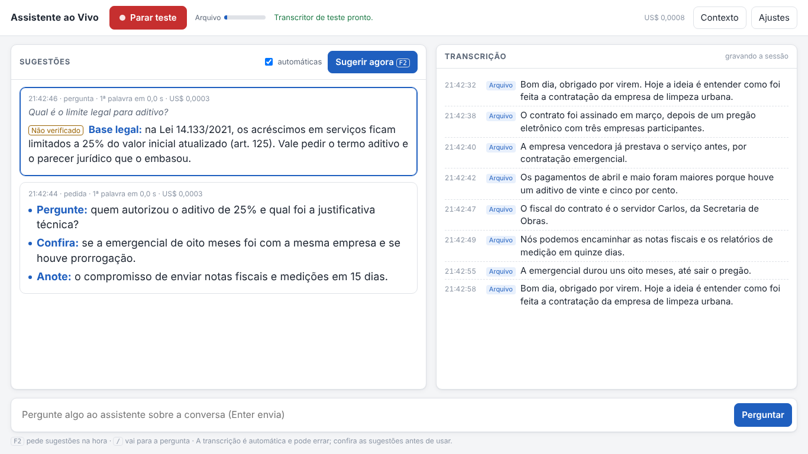

# Assistente ao Vivo

Ajuda durante conversas de trabalho: o computador ouve a conversa, o Whisper transcreve no próprio computador e o Claude sugere, em poucos segundos, perguntas, pontos de atenção e o que anotar. A qualquer momento você também pode digitar uma pergunta sobre a conversa.



## Instalar (uma vez)

1. Abra o menu Iniciar, digite **PowerShell** e abra o **Windows PowerShell**.
2. Cole a linha abaixo e aperte Enter:

   ```
   irm https://raw.githubusercontent.com/jpvanacor/assistente-ao-vivo/main/instalar.ps1 | iex
   ```

3. Espere. Na primeira vez ele baixa o Python e as bibliotecas (cerca de 120 MB). Quando a página abrir no navegador, ele baixa o modelo do Whisper (cerca de 480 MB); o andamento aparece no alto da página.
4. No fim, fica um atalho **Assistente ao Vivo** na Área de Trabalho.

## Usar

1. Clique duas vezes no atalho **Assistente ao Vivo**. Abre uma janela preta minimizada (é o programa; não feche) e a página abre no navegador.
2. Na primeira vez: **Ajustes** > **Chave da API** > cole a chave > **Salvar chave** (veja abaixo como criar a chave).
3. Antes da conversa: **Contexto** > escolha o tipo de conversa > cole o resumo do caso e o objetivo > **Salvar**.
4. Clique em **Ouvir**.
5. Durante a conversa:
   - As sugestões aparecem sozinhas quando há fala nova (no máximo uma a cada 20 segundos; dá para mudar em Ajustes).
   - Aperte **F2** para pedir ajuda na hora.
   - Digite uma pergunta na caixa de baixo e aperte **Enter**.
6. Clique em **Parar** no fim. A conversa inteira, com as sugestões, fica gravada num arquivo .md (**Ajustes** > **Abrir pasta**).

Para fechar o programa: feche a janela preta, ou **Ajustes** > **Fechar o programa**.

## Chave da API do Claude

O plano do app Claude não inclui a API. A API tem conta e créditos próprios.

1. Entre em [platform.claude.com](https://platform.claude.com) (crie a conta se precisar).
2. Em [Billing](https://platform.claude.com/settings/billing), adicione créditos.
3. Em [API keys](https://platform.claude.com/settings/keys), clique em **Create key**, escolha um workspace (pode ser o Default), dê um nome e copie a chave. Ela começa com `sk-ant-` e só aparece uma vez.

Custo: o Claude Haiku 5.5 cobra US$ 0,10 por milhão de tokens de entrada e US$ 0,50 por milhão de tokens de saída. O custo da sessão aparece no canto de cima da página. [Inferência] Uma hora de conversa com sugestões automáticas deve custar poucos centavos de dólar no Haiku.

## Testar sem falar

**Ajustes** > **Testar sem falar** > escolha uma gravação (por exemplo, um MP3 do Plaud) > **Tocar**. O programa toca o arquivo como se fosse a conversa ao vivo. Serve para ver a velocidade do Whisper no seu computador e o tipo de sugestão que o Claude dá.

## Opções (em Ajustes)

- **Quem transcreve**: Whisper neste computador (o áudio não sai daqui) ou Chrome (mais rápido, mas o áudio vai para o Google).
- **O que ouvir**: microfone (conversa na sala), áudio do computador (reunião on-line pelo Teams, Zoom ou Meet) ou os dois. Nos dois, use fone de ouvido; sem fone, o microfone também capta a voz dos outros e as falas se repetem.
- **Modelo do Whisper**: o automático usa o small no processador. Se aparecer o aviso de transcrição atrasada, escolha o base.
- **Vocabulário**: nomes e termos que o Whisper deve acertar (partes, município, empresas, servidores).
- **Modelo do Claude**: Haiku 5.5 (mais rápido) ou Sonnet 5.5 (mais cuidadoso, um pouco mais lento, custa mais).

## Privacidade

- Com o Whisper, o áudio não sai do computador. O texto da transcrição e o contexto vão para a API do Claude (Anthropic) a cada sugestão ou pergunta.
- Com o Chrome, o áudio vai para o Google.
- A chave da API, os ajustes e as sessões ficam em `%LOCALAPPDATA%\AssistenteAoVivo`.
- Antes de usar em audiências ou em casos sob sigilo, confira as regras do MP-RS sobre gravar conversas e enviar o conteúdo a serviços externos, e avise os participantes quando for o caso.

## Atualizações

O atalho baixa sozinho a versão mais nova do GitHub sempre que abre.

## Problemas comuns

- **"Não consegui abrir o microfone"**: nas Configurações do Windows, em Privacidade (ou Privacidade e segurança) > Microfone, ligue a permissão para aplicativos da área de trabalho.
- **Aviso de transcrição atrasada**: Ajustes > Modelo do Whisper > base.
- **A página não abriu**: abra `http://127.0.0.1:8765` no navegador.
- **A janela preta mostrou um erro**: copie as mensagens (ou tire uma foto) e mande para o Claude.

## Desinstalar

Apague o atalho da Área de Trabalho e a pasta `%LOCALAPPDATA%\AssistenteAoVivo`. Para liberar também o espaço do Whisper e das bibliotecas, apague `%LOCALAPPDATA%\uv`, `%APPDATA%\uv` e, em `%USERPROFILE%\.cache\huggingface\hub`, as pastas `models--Systran--faster-whisper-...`.

## Para desenvolver

```
uv run --python 3.12 python -m assistente            # abre o programa
uv run --with pytest python -m pytest tests -q        # testes (precisam de tests/_dados, veja tests/README.md)
```
